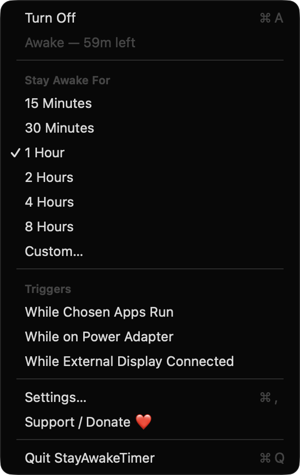
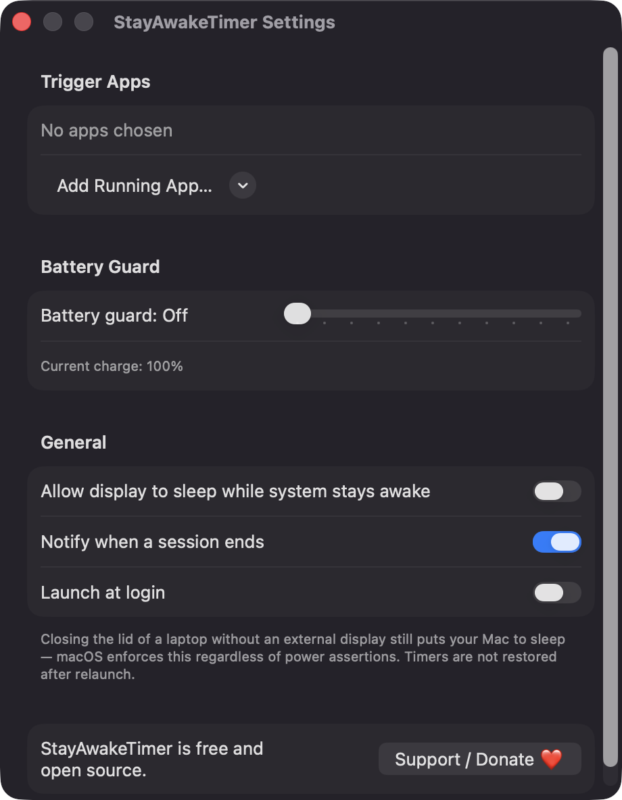
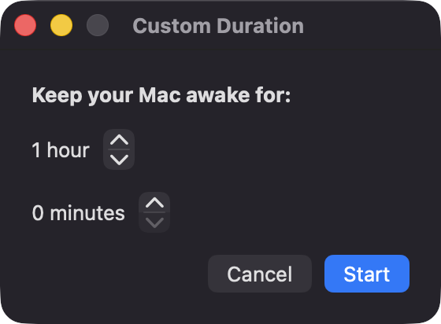

# StayAwakeTimer

**🌐 Website:** [turhe123.github.io/stay-awake-timer](https://turhe123.github.io/stay-awake-timer/)

Keep your Mac awake for a chosen time, until a download ends, or while certain apps run, from the menu bar.


## Why

StayAwakeTimer is a free, open-source, 100% native, backend-free alternative to paid utilities in the *Battery & Power* category. It was inspired by Lungo ($4.99 one-time), a polished menu bar app that keeps your Mac from sleeping. Everything here runs locally with Apple frameworks only.

## Features

- **One-click toggle** to stay awake indefinitely (⌘A in the menu).
- **Timed sessions**: 15 min, 30 min, 1, 2, 4 and 8 hours, plus a **custom** duration (up to 24 h 55 m).
- **Triggers** that keep your Mac awake automatically:
  - while any of your chosen apps are running (picked from currently running apps),
  - while the Mac is on the power adapter,
  - while an external display is connected.
- **Battery guard**: ends everything when on battery and the charge drops below a threshold (5–50%, or off).
- **Display sleep option**: let the screen sleep while the system stays awake.
- **Menu bar status**: empty cup when idle, filled cup when active, with time left (e.g. `1h 12m`) shown only while a timer runs.
- **Notifications** when a session ends or the battery guard fires (optional).
- **Launch at login** via `SMAppService`.
- **Safe by design**: overlapping reasons share a single power assertion, all assertions are released on quit, timers are not restored after relaunch, and the end time is stored as a date so clock changes are handled.
- A visible **Support / Donate ❤️** button in the menu and Settings.

> Note: the trigger rules in the current code cover running apps, power adapter and external display. There is no automatic "until a download finishes" trigger yet; you can approximate it by adding your download app as a trigger app or by using a timed session.

Closing the lid of a laptop without an external display still sleeps the Mac. macOS enforces this regardless of power assertions.

## Screenshots

<p align="center"></p>

<p align="center"><em>The menu bar menu during an active one-hour session, showing time left, preset durations, triggers and quick actions.</em></p>

<p align="center"></p>

<p align="center"><em>Settings for trigger apps, the battery guard, display sleep, notifications and launch at login.</em></p>

<p align="center"></p>

<p align="center"><em>Pick any custom duration in hours and minutes to keep your Mac awake.</em></p>

## Install

1. Download `StayAwakeTimer-macOS.zip` from the [latest release](https://github.com/turhe123/stay-awake-timer/releases/latest).
2. Unzip it and move `StayAwakeTimer.app` to `/Applications`.
3. Because the app is open source and not notarized, run:

   ```bash
   xattr -cr /Applications/StayAwakeTimer.app
   ```

4. Right-click the app → **Open** the first time.

## Build from source

Requires macOS 14+ and Xcode with Swift 5.9+.

```bash
brew install xcodegen
xcodegen generate
xcodebuild -project StayAwakeTimer.xcodeproj -scheme StayAwakeTimer -configuration Release -derivedDataPath ./build build
```

The app is produced at `build/Build/Products/Release/StayAwakeTimer.app`.

## Permissions

StayAwakeTimer needs very little:

- **Notifications** (optional): to tell you when a session ends or the battery guard stops it. Requested at launch; you can turn it off in Settings.
- **Login item** (optional): only if you enable "Launch at login".
- **No Accessibility, Screen Recording or Microphone access.** Running apps, battery state and displays are read through public APIs (`NSWorkspace`, IOKit power sources, `NSScreen`) that need no special permission.

## Built with AI

StayAwakeTimer was written by [Claude Code](https://claude.com/claude-code) inside an automated pipeline, from a plain-English spec. No code, binaries or assets from any commercial app were used; it is a clean-room reimplementation of a feature set, not a copy.

What that means in practice:

- The full source is in this repo under the MIT license. Read it before you run it.
- No network calls, no analytics, no third-party dependencies. Only Apple frameworks.
- Ad-hoc signed and not notarized, which is why Gatekeeper warns on first launch.
- It has had less human review than a hand-written app. Bug reports and pull requests are welcome.

## Support ❤️

If StayAwakeTimer is useful to you, you can support its development:

[Support Or (Leo) Davidai ❤️ on Ko-fi](https://ko-fi.com/leodavidai)

## License

MIT © Or Davidai Bachar
